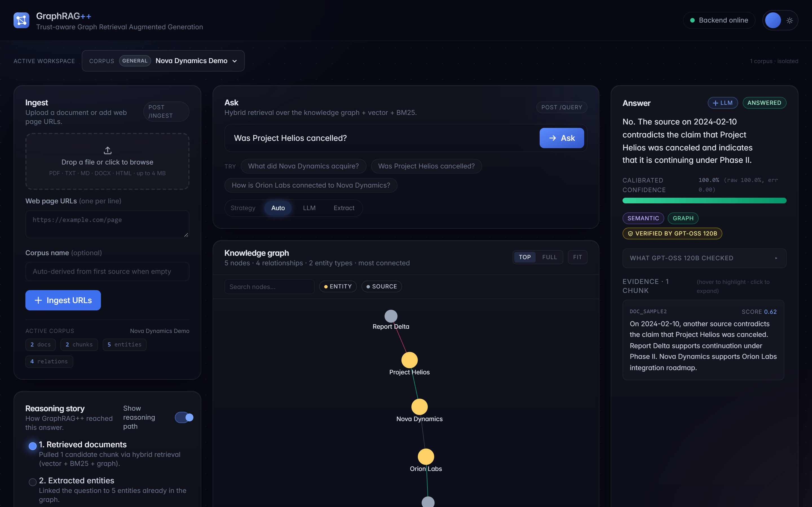
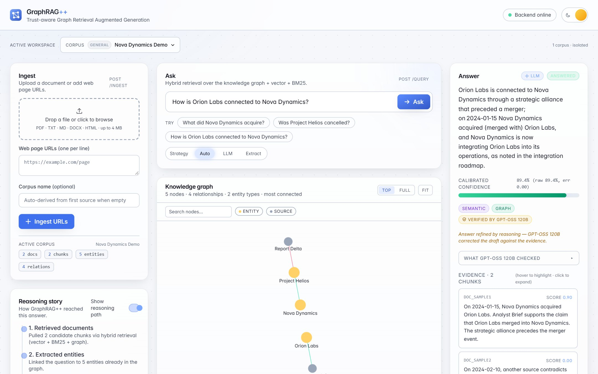
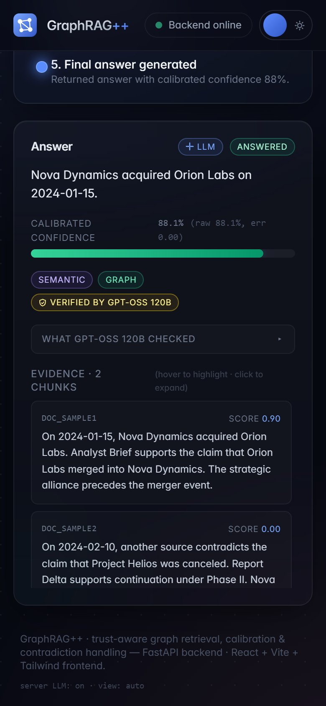
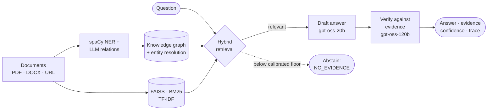

<div align="center">

# GraphRAG++

### Trust-aware Graph RAG: answers grounded in a knowledge graph, checked by a second reasoning model, and honest when the documents don't know.

[](https://graphrag-plus-dashboard.vercel.app)

[](https://github.com/saurabhshreni-cmyk/GraphRAG-Plus/actions/workflows/ci.yml)


[](LICENSE)

</div>



## At a glance

| | |
|---|---|
| **What it is** | A full-stack Graph RAG system. Upload documents and it builds a knowledge graph. Ask questions and it answers from graph + vector + keyword retrieval, has a larger model verify the answer, and shows its evidence and reasoning. |
| **Try it** | [graphrag-plus-dashboard.vercel.app](https://graphrag-plus-dashboard.vercel.app). Click an example question, or upload your own PDF / DOCX / TXT. |
| **Stack** | Python · FastAPI · FAISS · spaCy · NetworkX / Neo4j · Postgres · React · Vite · Tailwind |
| **AI models** | Groq `gpt-oss-20b` (extraction + answers) and `gpt-oss-120b` (verification) · Gemini embeddings; fully local alternatives via Ollama |
| **Runs on** | Vercel serverless + Neon Postgres, **$0/month, no credit card** |
| **Speed** | ~3.7 s median per question, end to end, including the verification pass |
| **Quality** | 254 automated tests · ruff · black · mypy · CI on every PR |

## Try it in 60 seconds

Open the [live demo](https://graphrag-plus-dashboard.vercel.app). It starts on a small demo corpus about a fictional company.

1. **"What did Nova Dynamics acquire?"** gives a grounded answer with its source passage and a confidence score.
2. **"Was Project Helios cancelled?"** shows how it handles **contradicting sources**. One document says the project was cancelled, another says it continues, and the answer explains which wins and why.
3. **"What is the capital of France?"** shows it **refusing** a question the documents can't answer (`NO_EVIDENCE`) instead of making something up.
4. **Upload your own document.** Watch it extract entities and relations into a graph, then ask about it.

Every answer is re-checked by a second, larger reasoning model. The badge says which one, and **"What GPT-OSS 120B checked"** shows its reasoning.

---

## Why it's more than a RAG demo

Most RAG demos embed chunks, retrieve the top-k and hand them to an LLM. GraphRAG++ adds the parts that make answers trustworthy:

| Problem with typical RAG | What GraphRAG++ does |
|---|---|
| Retrieval misses connected facts | **Hybrid retrieval**: BM25 keywords + dense vectors + a **knowledge-graph** signal |
| The graph fills with duplicate entities | **Entity resolution** merges "Apple", "Apple Inc" and "Apple Incorporated", but keeps "Apple Music" separate |
| The LLM hallucinates confidently | A **second reasoning model verifies** every answer against the evidence and can correct it |
| It answers even when nothing relevant was found | **Calibrated relevance floors** per embedding model; it abstains with `NO_EVIDENCE` |
| Conflicting sources get blended silently | **Contradiction detection** surfaces the conflict and how it was resolved |
| "Confidence" is a meaningless number | **Calibrated confidence** plus per-source **trust scores** |
| Stored answers go stale silently | **Graph versioning** flags answers whose supporting nodes changed |

<table>
<tr>
<td width="70%" valign="top"></td>
<td width="30%" valign="top"></td>
</tr>
<tr>
<td><sub>The verifier in action: <i>"GPT-OSS 120B corrected the draft against the evidence"</i>.</sub></td>
<td><sub>Responsive down to phone width.</sub></td>
</tr>
</table>

---

## Architecture



The same code runs in the cloud and fully offline; only the model providers change, chosen automatically from the environment:

| Stage | Cloud (live demo) | Local |
|---|---|---|
| Relation extraction | Groq `openai/gpt-oss-20b` (JSON mode) | Ollama `qwen3.5:4b` |
| Draft answers | Groq `openai/gpt-oss-20b` | Ollama `qwen3.5:4b` |
| Answer verification | Groq `openai/gpt-oss-120b`, high reasoning effort | Ollama `deepseek-r1:8b` |
| Embeddings | Gemini `gemini-embedding-001` (1024-dim) | `BAAI/bge-large-en-v1.5` (1024-dim) |
| Graph signal | In-process graph (entity matches) | Neo4j Personalized PageRank when `NEO4J_*` is set |
| Storage | Neon Postgres, shared by all serverless instances | Local disk |

Every model is optional and degrades gracefully. Without an LLM the system answers extractively; without embeddings it uses BM25, TF-IDF and the graph.

---

## Engineering highlights

The parts I'd talk through in an interview: real problems found and fixed while taking this from a laptop to a free public deployment.

- **Fit a GPU-era stack into a free serverless function.**
  - PyTorch and Neo4j alone would exceed Vercel's 500 MB limit for Python, so local models were swapped for hosted free-tier APIs behind the same interfaces.
  - The bundle is about 370 MB.
  - Each provider is picked at runtime: Ollama locally, Groq and Gemini in the cloud.
- **Calibrated retrieval per embedding model.**
  - Similarity scores aren't comparable across models: Gemini rates unrelated text higher than bge-large does.
  - [`calibrate_backend.py`](graphrag_plus/scripts/calibrate_backend.py) measures each model's on-topic vs off-topic separation (Gemini: a 0.20 gap) and derives the relevance floors.
  - A regression test reproduces the off-topic leak those floors prevent.
- **Stateless serverless, stateful app.**
  - Corpora live in Postgres and are hydrated on demand by whichever instance serves the request.
  - FAISS indexes are stored with each corpus, so a new instance reuses them instead of re-embedding everything. That matters on a free API quota.
  - Writes are guarded against stale instances overwriting newer data.
- **Debugged in production, not just locally.**
  - Groq calls were silently failing: Cloudflare blocks Python's default User-Agent.
  - gpt-oss returned empty answers because its hidden reasoning used up the token budget.
  - A pasted API key carried a trailing newline.
  - "Based in Boulder" vs "based in Colorado" was flagged as a contradiction.
  - Each fix came with a regression test.
- **Secure by default for a public demo.**
  - Per-client rate limits and a 4 MB upload cap.
  - SSRF-guarded URL ingestion.
  - The demo corpus is protected from deletion.
  - A logging filter that redacts API keys, bearer tokens and database URLs from every log line.
- **Entity resolution without false merges.**
  - Union-find clustering over string, prefix and embedding similarity.
  - Legal-suffix normalisation ("Inc", "Incorporated").
  - An ambiguity guard, so a company never absorbs its own product.

---

## Features

| Area | Highlights |
|---|---|
| **Retrieval** | BM25 + FAISS dense vectors + graph signal, weighted blend, calibrated floors, intent-aware boosts |
| **Knowledge graph** | spaCy NER + LLM-extracted typed relations (`acquired`, `founded_by`, `headquartered_in`, …), entity resolution, per-corpus isolation, versioning |
| **Answering** | Grounded LLM drafts, reasoning-model verification with a visible trace, extractive fallback, analyst mode with follow-up questions |
| **Trust** | Abstention (`NO_EVIDENCE`, `LOW_CONFIDENCE`, `CONFLICTING_EVIDENCE`, …), contradiction detection, calibrated confidence, per-source trust |
| **Dashboard** | Drag-and-drop upload, interactive force-directed graph with the query path in red, evidence with per-signal scores, step-by-step reasoning story, corpus workspaces, dark/light themes, mobile layout |
| **Operations** | Free-tier deployment, rate limiting, secret redaction, Prometheus `/metrics`, per-stage latency, JSONL run logs |

---

## Tech stack

| Layer | Technologies |
|---|---|
| Backend | Python 3.11–3.13, FastAPI, Pydantic v2, Uvicorn |
| Retrieval & NLP | FAISS, rank-bm25, NumPy TF-IDF, spaCy `en_core_web_sm` |
| LLMs & embeddings | Groq (gpt-oss-20b / 120b), Gemini embeddings, Jina; Ollama (qwen3.5, DeepSeek R1) and sentence-transformers (bge-large) locally |
| Graph & storage | NetworkX, Neo4j (optional), Postgres via psycopg 3 (Neon) |
| Frontend | React 18, Vite 5, Tailwind CSS 3, Framer Motion, react-force-graph-2d |
| Infra & quality | Vercel (serverless Python + static), GitHub Actions, pytest, ruff, black, mypy |

---

## Run it locally

Python 3.11–3.13 and Node 18+.

```bash
git clone https://github.com/saurabhshreni-cmyk/GraphRAG-Plus.git
cd GraphRAG-Plus
python -m venv venv && . venv/bin/activate      # Windows: venv\Scripts\activate
pip install -r requirements.txt

PYTHONPATH=. uvicorn graphrag_plus.app.api.main:app --port 8765
```

```bash
cd frontend && npm install && npm run dev      # http://localhost:5173
```

It works with no keys at all (extractive answers over BM25 + TF-IDF + graph). Add capabilities through the environment:

| Set | To get |
|---|---|
| Ollama running locally | Local LLM extraction, answers and DeepSeek R1 verification |
| `GROQ_API_KEY` | Hosted LLMs (Groq free tier) |
| `GEMINI_API_KEY` | Hosted embeddings, or `pip install sentence-transformers` for local bge-large |
| `GRAPHRAG_DATABASE_URL` | Postgres storage |
| `NEO4J_URI`, `NEO4J_USERNAME`, `NEO4J_PASSWORD` | Neo4j graph with Personalized PageRank |

Deploying your own copy for free takes about 15 minutes: see **[deploy/DEPLOYMENT.md](deploy/DEPLOYMENT.md)**.

---

<details>
<summary><b>REST API</b></summary>

| Method | Path | Purpose |
|--------|------|---------|
| `GET`  | `/health` | Liveness + whether an LLM is enabled |
| `POST` | `/ingest/file` | Upload one document (multipart, ≤ 4 MB) into a new or existing corpus |
| `POST` | `/ingest` | Ingest URLs (or server-side file paths when self-hosted) |
| `POST` | `/query` | Hybrid retrieval + generated, verified answer (optional `corpus_id`) |
| `GET`  | `/corpora` | List corpora with counts and a `deletable` flag |
| `GET`  | `/corpora/active` | The active corpus |
| `POST` | `/corpora/{id}/select` | Switch the active corpus |
| `DELETE` | `/corpora/{id}` | Delete a corpus (the demo corpus is refused) |
| `GET`  | `/corpora/{id}/chunks` | Paginated chunks of a corpus |
| `GET`  | `/graph` | Graph snapshot for visualization (`mode=important\|full`) |
| `GET`  | `/graph/{corpus_id}/full` | Full graph of a corpus |
| `GET`  | `/graph/{corpus_id}/stats` | Node and relationship counts by type, most-connected entities |
| `GET`  | `/graph/{corpus_id}/query-path?q=` | Entities a question traverses |
| `GET`  | `/graph/{corpus_id}/entity/{name}` | An entity with its neighbours and source chunks |
| `GET`  | `/graph/{node_id}` | Neighbourhood of a graph node |
| `GET`  | `/evaluate` | Run the lightweight benchmark |
| `GET`  | `/metrics` | Prometheus exposition |

```bash
curl -X POST https://graphrag-plus-api.vercel.app/query \
  -H "Content-Type: application/json" \
  -d '{"question": "Was Project Helios cancelled?", "corpus_id": "corpus_demo_nova"}'
```

```json
{
  "answer": "No. The source on 2024-02-10 contradicts the claim that Project Helios was canceled and indicates that it is continuing under Phase II.",
  "generated_by": "llm",
  "verified_by_reasoning": true,
  "reasoning_model": "openai/gpt-oss-120b",
  "calibrated_confidence": 0.75,
  "failure_type": null,
  "evidence": [{"source_id": "doc_sample2", "raw_semantic": 0.79, "raw_bm25": 0.41, "final_score": 0.9}],
  "graph_version_id": "v20261127045544009648"
}
```

Public-demo rate limits per client, tunable through the environment:

| Requests | Limit |
|---|---|
| `/query` | 20 per minute |
| `/ingest*` | 6 per 10 minutes |
| Corpus deletes | 10 per 10 minutes |

Set `GRAPHRAG_RATE_LIMIT=0` to turn them off locally. More ready-to-run requests are in [`api_requests.http`](graphrag_plus/examples/api_requests.http).

</details>

<details>
<summary><b>Project structure</b></summary>

```
GraphRAG-Plus/
├── index.py                    ← Vercel entrypoint (FastAPI app)
├── requirements.txt            ← the deployed API bundle
├── vercel.json                 ← function settings (300 s max duration)
├── deploy/DEPLOYMENT.md        ← free deployment guide
├── docs/images/                ← README screenshots
├── frontend/                   ← React + Vite + Tailwind dashboard
│   └── src/
│       ├── App.jsx             ← layout + state
│       ├── api.js              ← API client
│       ├── suggestions.js      ← corpus-aware example questions
│       └── components/         ← IngestPanel, QueryBox, ResultCard, GraphView,
│                                 ReasoningStory, CorpusSelector, Header, ...
└── graphrag_plus/
    ├── pyproject.toml          ← deps, extras, ruff/black/mypy config
    ├── scripts/                ← calibrate_backend.py, check_postgres.py, quality gate
    └── app/
        ├── pipeline.py         ← end-to-end orchestration
        ├── api/                ← routes, rate limiting, serverless entry
        ├── ingestion/          ← file + URL loaders (SSRF-guarded), chunker
        ├── extraction/         ← spaCy NER + LLM relation extraction (Ollama / Groq)
        ├── graph/              ← NetworkX + Neo4j stores, entity resolution, versioning
        ├── corpus/             ← multi-corpus manager, Postgres store, demo seed
        ├── embeddings/         ← local + remote embedders, FAISS store
        ├── retrieval/          ← hybrid retrieval, TF-IDF
        ├── generation/         ← answer generation, LLM clients, reasoning verifier
        ├── contradiction/      ← disagreement detection on single-valued facts
        ├── scoring/ trust/ calibration/ failure/ analyst/ planning/ ...
        ├── utils/              ← logging (with secret redaction), HTTP helpers, IO
        └── tests/              ← 254 tests
```

</details>

<details>
<summary><b>Configuration, observability and development</b></summary>

**Configuration.** Settings live in [`settings.py`](graphrag_plus/app/config/settings.py) (env prefix `GRAPHRAG_`, or a `.env` file). Cloud-specific variables:

| Variable | Purpose |
|---|---|
| `GROQ_API_KEY` | Groq LLMs for extraction, answers and verification |
| `GEMINI_API_KEY` / `JINA_API_KEY` | Hosted embeddings |
| `GRAPHRAG_DATABASE_URL` | Postgres for durable, shared corpora |
| `GRAPHRAG_MIN_COSINE_SEMANTIC`, `GRAPHRAG_STRONG_COSINE_SEMANTIC`, `GRAPHRAG_RESOLVER_EMBEDDING_THRESHOLD` | Calibrated per embedding model |
| `GRAPHRAG_CORS_ORIGINS` | Allowed dashboard origins |

The full list is in the [deployment guide](deploy/DEPLOYMENT.md#environment-variable-reference).

**Observability.**
- Every query records:
  - its graph version
  - raw and calibrated confidence
  - per-evidence trust, semantic, BM25, graph and final scores
  - the failure type
  - per-stage latency
- `GET /metrics` exposes Prometheus counters and histograms (`graphrag_queries_total`, `graphrag_query_latency_seconds`, `graphrag_module_latency_seconds`, `graphrag_stage_errors_total`, …).
- A logging filter replaces API keys, bearer tokens and database URLs with `[REDACTED]`.

**Development.**

```bash
cd graphrag_plus && pip install -e .[dev]
ruff check . && black --check . && mypy app && pytest
```

- **CI:** GitHub Actions runs these on Python 3.11 and 3.12 for every PR.
- **Previews:** Vercel builds a preview of the API and the dashboard for each PR.
- **Production:** deploys from `main`.
- **Windows:** `graphrag_plus\scripts\quality_gate.ps1` runs the same gate plus a frontend build.

</details>

---

## Roadmap

- **Personalized PageRank on the in-process graph**, so the cloud demo gets the same multi-hop graph signal as a Neo4j deployment
- **An answer-quality benchmark** (exact match / faithfulness on a labelled question set) tracked in CI
- **Async ingest** with progress streaming for large documents
- **Auth** for write endpoints, beyond the current rate limits

## Further reading

- [Free deployment guide](deploy/DEPLOYMENT.md): Vercel + Groq + Gemini + Neon, step by step
- [End-to-end test report](docs/E2E_RESULTS_V2.md): the full local stack (bge-large, qwen3.5, DeepSeek R1, Neo4j with PageRank) run against real documents
- [System notes](docs/PROGRESS.md): architecture, model choices and known limitations

## Author

Built by **Saurabh Shreni** ([@saurabhshreni-cmyk](https://github.com/saurabhshreni-cmyk)). Questions and feedback are welcome via [issues](https://github.com/saurabhshreni-cmyk/GraphRAG-Plus/issues).

## License

[MIT](LICENSE)
